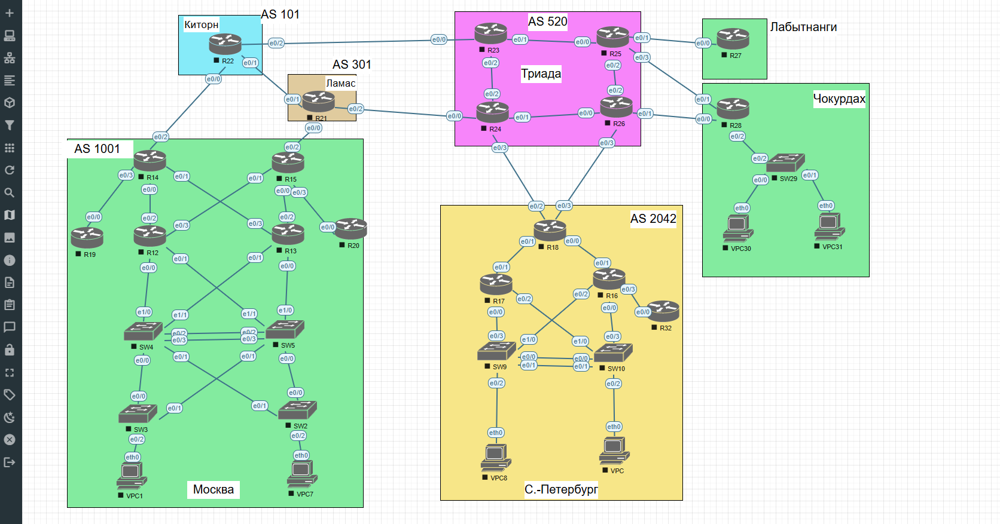

# Лабораторная работа №1. Проектирование сети

## Цель работы

Разработать схему IPv4-адресации для корпоративной сети с несколькими офисами и автономными системами, выполнить базовую настройку сетевых устройств, организовать разделение пользовательских сетей по VLAN и обеспечить устойчивую работу локальных сетей при наличии избыточных соединений.

## Задание

1. Разработать и задокументировать адресное пространство лабораторного стенда.
2. Назначить IPv4-адреса всем используемым интерфейсам третьего уровня.
3. Разместить каждый VPC в офисах в отдельном VLAN.
4. Настроить VLAN управления и/или интерфейсы Loopback для сетевых устройств.
5. Настроить механизмы предотвращения петель второго уровня и рационального использования резервных физических каналов.
6. Использовать протокол IPv4.

## Исходная топология



Стенд объединяет офисные и транзитные сегменты:

| Сегмент | Автономная система | Оборудование |
| --- | --- | --- |
| Москва | AS 1001 | R12–R15, R19, R20, SW2–SW5, VPC1, VPC7 |
| Санкт-Петербург | AS 2042 | R16–R18, R32, SW9, SW10, VPC8, VPC |
| Киторн | AS 101 | R22 |
| Ламас | AS 301 | R21 |
| Триада | AS 520 | R23–R26 |
| Лабытнанги | Не указана на схеме | R27 |
| Чокурдах | Не указана на схеме | R28, SW29, VPC30, VPC31 |

По файлу исходной топологии стенд включает **31 устройство**: 18 маршрутизаторов, 7 коммутаторов и 6 виртуальных ПК (VPCS). В топологии определено 46 соединений.

## План выполнения

1. Составление адресного плана и таблицы соединений.
2. Базовая настройка маршрутизаторов и Loopback-интерфейсов.
3. Настройка VLAN, trunk-портов и управляющих SVI.
4. Настройка STP и EtherChannel в офисах с резервными соединениями.
5. Настройка шлюзов пользовательских VLAN и локальной межвлановой маршрутизации.
6. Проверка адресации, связности и устойчивости сети при отключении отдельных каналов.
7. Сохранение конфигураций устройств и результатов проверки.

---

## Адресный план

Для лабораторного стенда используется частное адресное пространство `10.0.0.0/8`. Подсети распределяются по назначению, что позволит расширять адресный план при настройке остальных сегментов сети.

| Адресное пространство | Назначение |
| --- | --- |
| `10.0.0.0/24` | Соединения между маршрутизаторами (подсети `/30`) |
| `10.100.0.0/16` | Пользовательские и управляющие сети Москвы (AS 1001) |
| `10.200.0.0/16` | Пользовательские и управляющие сети Санкт-Петербурга (AS 2042) |
| `10.30.0.0/16` | Пользовательские и управляющие сети Чокурдаха |
| `10.255.0.0/24` | Loopback-интерфейсы маршрутизаторов (`/32`) |

### Адресация первого межмаршрутизаторного соединения

| Устройство | Интерфейс | IPv4-адрес | Подсеть | Соседнее устройство |
| --- | --- | --- | --- | --- |
| R12 | Ethernet0/2 | `10.0.0.1/30` | `10.0.0.0/30` | R14 Ethernet0/0 |
| R14 | Ethernet0/0 | `10.0.0.2/30` | `10.0.0.0/30` | R12 Ethernet0/2 |

### Loopback-интерфейсы

| Устройство | Интерфейс | IPv4-адрес |
| --- | --- | --- |
| R12 | Loopback0 | `10.255.0.12/32` |
| R14 | Loopback0 | `10.255.0.14/32` |

Адреса остальных соединений, VLAN и Loopback-интерфейсов будут добавлены в таблицы по мере настройки соответствующих сегментов.

## Базовая настройка маршрутизаторов

На первом этапе настроены маршрутизаторы R12 и R14 московского сегмента AS 1001: заданы имена устройств, IPv4-адреса физических интерфейсов, интерфейсы Loopback0. Выводы `show running-config` **на момент окончания первого этапа** сохранены как [`configs/stage1/R12.txt`](configs/stage1/R12.txt) и [`configs/stage1/R14.txt`](configs/stage1/R14.txt). После второго этапа конфигурации этих устройств изменились.

### R12

Фрагмент фактической конфигурации:

```text
hostname R12
no ip domain lookup
!
interface Loopback0
 ip address 10.255.0.12 255.255.255.255
!
interface Ethernet0/2
 description TO_R14_E0/0
 ip address 10.0.0.1 255.255.255.252
```

### R14

Фрагмент фактической конфигурации:

```text
hostname R14
no ip domain lookup
!
interface Loopback0
 ip address 10.255.0.14 255.255.255.255
!
interface Ethernet0/0
 description TO_R12_E0/2
 ip address 10.0.0.2 255.255.255.252
```

### Проверка конфигурации и связности

Для проверки использованы команды `show ip interface brief`, `show ip route connected`, `show running-config` и `ping`.

| Устройство | Интерфейс | IPv4-адрес | Status | Protocol |
| --- | --- | --- | --- | --- |
| R12 | Ethernet0/2 | `10.0.0.1` | up | up |
| R12 | Loopback0 | `10.255.0.12` | up | up |
| R14 | Ethernet0/0 | `10.0.0.2` | up | up |
| R14 | Loopback0 | `10.255.0.14` | up | up |

На обоих маршрутизаторах присутствует непосредственно подключённая сеть `10.0.0.0/30`. На R12 она доступна через `Ethernet0/2`, на R14 — через `Ethernet0/0`.

**R12 → R14:**

```text
R12#ping 10.0.0.2
Type escape sequence to abort.
Sending 5, 100-byte ICMP Echos to 10.0.0.2, timeout is 2 seconds:
!!!!!
Success rate is 100 percent (5/5), round-trip min/avg/max = 1/1/2 ms
```

**R14 → R12:**

```text
R14#ping 10.0.0.1
Type escape sequence to abort.
Sending 5, 100-byte ICMP Echos to 10.0.0.1, timeout is 2 seconds:
!!!!!
Success rate is 100 percent (5/5), round-trip min/avg/max = 1/1/1 ms
```

**Результат:** оба маршрутизатора имеют рабочие физические и Loopback-интерфейсы. Связность по IPv4 между R12 и R14 подтверждена в обоих направлениях, потерь ICMP-пакетов нет.


---

## Расширение магистральной сети Москвы

Во втором этапе настроены маршрутизаторы R13, R15, R19 и R20, а на R12 и R14 добавлены новые межмаршрутизаторные соединения. По фактическим выводам `show ip interface brief` и `show ip route connected` подтверждена работа шести физических линков и шести Loopback-интерфейсов. Состояние всех задействованных интерфейсов — `up/up`.

Актуальные конфигурации устройств после второго этапа: [R12](configs/R12.txt), [R13](configs/R13.txt), [R14](configs/R14.txt), [R15](configs/R15.txt), [R19](configs/R19.txt), [R20](configs/R20.txt). Они сохранены по предоставленным выводам `show running-config` Cisco IOS 15.4 от 22.10.2026. Исторические снимки первого этапа сохранены отдельно в `configs/stage1/`.

### Проверка интерфейсов

| Маршрутизатор | Физический интерфейс | IPv4-адрес | Статус | Loopback0 |
| --- | --- | --- | --- | --- |
| R12 | Ethernet0/2 | `10.0.0.1/30` | up/up | `10.255.0.12/32` |
| R12 | Ethernet0/3 | `10.0.0.13/30` | up/up | |
| R13 | Ethernet0/2 | `10.0.0.5/30` | up/up | `10.255.0.13/32` |
| R13 | Ethernet0/3 | `10.0.0.9/30` | up/up | |
| R14 | Ethernet0/0 | `10.0.0.2/30` | up/up | `10.255.0.14/32` |
| R14 | Ethernet0/1 | `10.0.0.10/30` | up/up | |
| R14 | Ethernet0/3 | `10.0.0.29/30` | up/up | |
| R15 | Ethernet0/0 | `10.0.0.6/30` | up/up | `10.255.0.15/32` |
| R15 | Ethernet0/1 | `10.0.0.14/30` | up/up | |
| R15 | Ethernet0/3 | `10.0.0.25/30` | up/up | |
| R19 | Ethernet0/0 | `10.0.0.30/30` | up/up | `10.255.0.19/32` |
| R20 | Ethernet0/0 | `10.0.0.26/30` | up/up | `10.255.0.20/32` |

Остальные, пока не используемые физические интерфейсы находятся в состоянии `administratively down/down`. Это ожидаемо на текущем этапе.

### Проверка подключённых маршрутов

На маршрутизаторах обнаружены следующие маршруты типа `C` (connected):

| Маршрутизатор | Подключённые сети |
| --- | --- |
| R12 | `10.0.0.0/30`, `10.0.0.12/30`, `10.255.0.12/32` |
| R13 | `10.0.0.4/30`, `10.0.0.8/30`, `10.255.0.13/32` |
| R14 | `10.0.0.0/30`, `10.0.0.8/30`, `10.0.0.28/30`, `10.255.0.14/32` |
| R15 | `10.0.0.4/30`, `10.0.0.12/30`, `10.0.0.24/30`, `10.255.0.15/32` |
| R19 | `10.0.0.28/30`, `10.255.0.19/32` |
| R20 | `10.0.0.24/30`, `10.255.0.20/32` |

В выводе также присутствуют локальные маршруты типа `L` для IPv4-адресов физических интерфейсов. Маршрут по умолчанию отсутствует, поскольку маршрутизация между удалёнными сетями на данном этапе не настраивалась.

### Проверка межмаршрутизаторной связности

| Источник | Назначение | Подсеть | Отправлено | Получено | Успешность |
| --- | --- | --- | --- | --- | --- |
| R12 | R14 (`10.0.0.2`) | `10.0.0.0/30` | 5 | 5 | 100% |
| R13 | R15 (`10.0.0.6`) | `10.0.0.4/30` | 5 | 5 | 100% |
| R13 | R14 (`10.0.0.10`) | `10.0.0.8/30` | 5 | 5 | 100% |
| R12 | R15 (`10.0.0.14`) | `10.0.0.12/30` | 5 | 5 | 100% |
| R15 | R20 (`10.0.0.26`) | `10.0.0.24/30` | 5 | 5 | 100% |
| R14 | R19 (`10.0.0.30`) | `10.0.0.28/30` | 5 | 5 | 100% |

Примеры фактических результатов:

**R12 → R15:**

```text
R12#ping 10.0.0.14
!!!!!
Success rate is 100 percent (5/5), round-trip min/avg/max = 1/1/1 ms
```

**R13 → R15, повторная проверка:**

```text
R13#ping 10.0.0.6
!!!!!
Success rate is 100 percent (5/5), round-trip min/avg/max = 1/1/1 ms
```

**Результат этапа:** все шесть магистральных соединений Москвы проверены, интерфейсы имеют состояние `up/up`, подключённые маршруты соответствуют адресному плану. После повторных ICMP-проверок потери не наблюдаются. Полные актуальные конфигурации шести маршрутизаторов сохранены в `configs/`.


---

## Настройка маршрутизаторов Санкт-Петербурга

В сегменте AS 2042 выполнена базовая настройка R16, R17, R18 и R32. Физическим интерфейсам межмаршрутизаторных соединений назначены IPv4-адреса из отдельной подсети `/30` для каждого линка; на всех четырёх устройствах настроены Loopback0 `/32`.

### Проверка состояния интерфейсов

| Маршрутизатор | Интерфейс | IPv4-адрес | Status/Protocol | Loopback0 |
| --- | --- | --- | --- | --- |
| R16 | Ethernet0/1 | `10.0.0.17/30` | up/up | `10.255.0.16/32` |
| R16 | Ethernet0/3 | `10.0.0.89/30` | up/up | |
| R17 | Ethernet0/1 | `10.0.0.21/30` | up/up | `10.255.0.17/32` |
| R18 | Ethernet0/0 | `10.0.0.18/30` | up/up | `10.255.0.18/32` |
| R18 | Ethernet0/1 | `10.0.0.22/30` | up/up | |
| R32 | Ethernet0/0 | `10.0.0.90/30` | up/up | `10.255.0.32/32` |

Все Loopback0 также имеют состояние `up/up`. Остальные физические интерфейсы на этих маршрутизаторах находятся в состоянии `administratively down/down`, что соответствует текущему этапу.

### Проверка подключённых маршрутов

На маршрутизаторах командой `show ip route connected` подтверждены следующие маршруты типа `C`:

| Маршрутизатор | Подключённые сети |
| --- | --- |
| R16 | `10.0.0.16/30`, `10.0.0.88/30`, `10.255.0.16/32` |
| R17 | `10.0.0.20/30`, `10.255.0.17/32` |
| R18 | `10.0.0.16/30`, `10.0.0.20/30`, `10.255.0.18/32` |
| R32 | `10.0.0.88/30`, `10.255.0.32/32` |


### Проверка межмаршрутизаторной связности

Проверена ICMP-связность на всех трёх соединениях в обоих направлениях. Ниже приведены **фактические результаты** предоставленных команд Cisco IOS. При первоначальном `ping` на отдельных направлениях терялся первый ICMP-пакет; повторные проверки выполнились без потерь.

| Источник | Назначение | Первоначальная проверка | Итоговая проверка | RTT min/avg/max |
| --- | --- | --- | --- | --- |
| R16 | R18 (`10.0.0.18`) | 4/5 | 5/5 (100%) | 1/1/1 мс |
| R18 | R16 (`10.0.0.17`) | 5/5 | 5/5 (100%) | 1/1/1 мс |
| R17 | R18 (`10.0.0.22`) | 4/5 | 5/5 (100%) | 1/1/1 мс |
| R18 | R17 (`10.0.0.21`) | 5/5 | 5/5 (100%) | 1/1/1 мс |
| R16 | R32 (`10.0.0.90`) | 4/5 | 5/5 (100%) | 1/1/1 мс |
| R32 | R16 (`10.0.0.89`) | 5/5 | 5/5 (100%) | 1/1/1 мс |

Примеры подтверждённого вывода:

**R16 → R18, повторная проверка:**

```text
R16#ping 10.0.0.18
!!!!!
Success rate is 100 percent (5/5), round-trip min/avg/max = 1/1/1 ms
```

**R17 → R18, первый и повторный запросы:**

```text
R17#ping 10.0.0.22
.!!!!
Success rate is 80 percent (4/5), round-trip min/avg/max = 1/1/1 ms
R17#ping 10.0.0.22
!!!!!
Success rate is 100 percent (5/5), round-trip min/avg/max = 1/1/1 ms
```

Потеря первого ICMP-пакета согласуется с первоначальным ARP-разрешением адреса соседа; последующие успешные проверки подтверждают отсутствие устойчивой потери пакетов на протестированных соединениях.

**Результат этапа:** адресация, маршруты connected, работа шести физических интерфейсов, четырёх Loopback0 и двухсторонняя связность трёх магистральных линков подтверждены. Внешние соединения, пользовательские VLAN и маршрутизация между удалёнными сетями на этом этапе не проверялись.

### Сохранённые конфигурации маршрутизаторов Санкт-Петербурга

Фактические выводы `show running-config` получены с каждого маршрутизатора и сохранены в каталоге `configs/`:

| Маршрутизатор | Конфигурация | Настроенные физические интерфейсы |
| --- | --- | --- |
| R16 | [`configs/R16.txt`](configs/R16.txt) | Ethernet0/1, Ethernet0/3 |
| R17 | [`configs/R17.txt`](configs/R17.txt) | Ethernet0/1 |
| R18 | [`configs/R18.txt`](configs/R18.txt) | Ethernet0/0, Ethernet0/1 |
| R32 | [`configs/R32.txt`](configs/R32.txt) | Ethernet0/0 |

Во всех конфигурациях подтверждены hostname, `no ip domain lookup`, IPv4-адреса задействованных портов и Loopback0. Неиспользуемые физические интерфейсы находятся в `shutdown`


## Настройка транзитных маршрутизаторов и удалённых узлов

Выполнена базовая IPv4-настройка маршрутизаторов R21–R28 и дополнены физические интерфейсы R14, R15 и R18. Всего в рамках этапа настроены 14 новых соединений Router-to-Router и восемь новых Loopback0. Избыточные соединения R23–R26 и R25–R28 представлены отдельными маршрутизируемыми подсетями `/30`.

### Проверка интерфейсов и маршрутов

На всех 14 соединениях оба физических интерфейса находятся в состоянии `up/up`. Для всех настроенных физических соединений в выводах `show ip route connected` присутствуют соответствующие маршруты типа `C`, а локальные адреса отображаются с кодом `L`.

| Устройство | Подключённые сети| Loopback0 |
| --- | --- | --- |
| R14 | `10.0.0.32/30` (дополнительно к ранее настроенным) | `10.255.0.14/32` |
| R15 | `10.0.0.36/30` (дополнительно к ранее настроенным) | `10.255.0.15/32` |
| R18 | `10.0.0.76/30`, `10.0.0.80/30` (дополнительно к ранее настроенным) | `10.255.0.18/32` |
| R21 | `10.0.0.36/30`, `10.0.0.40/30`, `10.0.0.48/30` | `10.255.0.21/32` |
| R22 | `10.0.0.32/30`, `10.0.0.40/30`, `10.0.0.44/30` | `10.255.0.22/32` |
| R23 | `10.0.0.44/30`, `10.0.0.52/30`, `10.0.0.72/30` | `10.255.0.23/32` |
| R24 | `10.0.0.48/30`, `10.0.0.56/30`, `10.0.0.72/30`, `10.0.0.76/30` | `10.255.0.24/32` |
| R25 | `10.0.0.52/30`, `10.0.0.60/30`, `10.0.0.68/30`, `10.0.0.84/30` | `10.255.0.25/32` |
| R26 | `10.0.0.56/30`, `10.0.0.64/30`, `10.0.0.68/30`, `10.0.0.80/30` | `10.255.0.26/32` |
| R27 | `10.0.0.60/30` | `10.255.0.27/32` |
| R28 | `10.0.0.64/30`, `10.0.0.84/30` | `10.255.0.28/32` |

Неиспользуемые порты остаются административно отключёнными; в частности, Ethernet0/2 маршрутизатора R28 будет задействован при настройке пользовательских VLAN Чокурдаха.

### Проверка межмаршрутизаторной связности

Каждая из 14 новых непосредственно подключённых пар проверена командой `ping`. В таблице приведены фактические результаты, полученные в Cisco IOS.

| Источник | Назначение | Соединение | Результат |
| --- | --- | --- | --- |
| R14 | `10.0.0.34` | R14 → R22 | 5/5 (100%) |
| R15 | `10.0.0.38` | R15 → R21 | 5/5 (100%) |
| R21 | `10.0.0.42` | R21 → R22 | 5/5 (100%) |
| R22 | `10.0.0.46` | R22 → R23 | 5/5 (100%) |
| R21 | `10.0.0.50` | R21 → R24 | 5/5 (100%) |
| R23 | `10.0.0.54` | R23 → R25 | 5/5 (100%) |
| R24 | `10.0.0.58` | R24 → R26 | 5/5 (100%) |
| R25 | `10.0.0.62` | R25 → R27 | 5/5 (100%) |
| R26 | `10.0.0.66` | R26 → R28 | 5/5 (100%) |
| R25 | `10.0.0.70` | R25 → R26 | 5/5 (100%) |
| R23 | `10.0.0.74` | R23 → R24 | 5/5 (100%) |
| R18 | `10.0.0.78` | R18 → R24 | 5/5 (100%) |
| R18 | `10.0.0.82` | R18 → R26 | 5/5 (100%) |
| R25 | `10.0.0.86` | R25 → R28 | 5/5 (100%) |

**R18 → R24 — завершающая проверка:**

```text
R18#ping 10.0.0.78
Type escape sequence to abort.
Sending 5, 100-byte ICMP Echos to 10.0.0.78, timeout is 2 seconds:
!!!!!
Success rate is 100 percent (5/5), round-trip min/avg/max = 1/1/1 ms
```

**Результат этапа:** все 14 транзитных подключений подтверждены успешными ICMP-запросами без потерь. В совокупности с этапами 1–3 настроены 18 Loopback0 и все 23 физических межмаршрутизаторных соединения (`up/up`). Маршрутизация между удалёнными IPv4-подсетями и пользовательские VLAN пока не настраивались, поэтому сквозная связность всех сегментов ещё не проверялась.

### Сохранение конфигураций

Получены фактические выводы `show running-config` для всех 11 маршрутизаторов, участвовавших в обновлении конфигураций. Файлы сохранены в каталоге `configs/`:

| Сегмент | Сохранённые конфигурации |
| --- | --- |
| Москва, дополненные устройства | [`R14.txt`](configs/R14.txt), [`R15.txt`](configs/R15.txt) |
| Санкт-Петербург, дополненное устройство | [`R18.txt`](configs/R18.txt) |
| AS 301 и AS 101 | [`R21.txt`](configs/R21.txt), [`R22.txt`](configs/R22.txt) |
| AS 520 | [`R23.txt`](configs/R23.txt), [`R24.txt`](configs/R24.txt), [`R25.txt`](configs/R25.txt), [`R26.txt`](configs/R26.txt) |
| Удалённые узлы | [`R27.txt`](configs/R27.txt), [`R28.txt`](configs/R28.txt) |


## Настройка L2-инфраструктуры Москвы

Настроены коммутаторы SW2–SW5 (Cisco IOL L2, IOS 15.2). Пользовательские VPC1 и VPC7 размещены в отдельных VLAN; для управляющих интерфейсов используется VLAN 199. Между SW4 и SW5 организован EtherChannel по LACP, для защиты от L2-петель — Rapid PVST+.

### VLAN и управление

| VLAN | Название | Назначение |
| --- | --- | --- |
| 101 | `USERS_VPC1` | VPC1, порт SW3 Ethernet0/2 |
| 102 | `USERS_VPC7` | VPC7, порт SW2 Ethernet0/2 |
| 199 | `MGMT` | Управляющие SVI коммутаторов |
| 901 | `TRANSIT_R12_R13` | Выделенный L2-сегмент для будущего соединения R12–R13 |

| Коммутатор | Управляющий IPv4-адрес | Статус интерфейса |
| --- | --- | --- |
| SW2 | `10.100.99.2/24` | `up/up` |
| SW3 | `10.100.99.3/24` | `up/up` |
| SW4 | `10.100.99.4/24` | `up/up` |
| SW5 | `10.100.99.5/24` | `up/up` |

Связность VLAN 199 подтверждена шестью ICMP-проверками между всеми парами коммутаторов: **5/5 (100%)** для каждой пары. Адрес `10.100.99.1` задан как будущий шлюз управления; на маршрутизаторе он пока не настроен.


### EtherChannel и trunk

Два соединения SW4 Ethernet0/2–0/3 ↔ SW5 Ethernet0/2–0/3 объединены в `Port-channel1` (LACP, mode `active`). На обоих устройствах получено:

```text
Po1(SU)    LACP    Et0/2(P) Et0/3(P)
```

`Po1` работает как trunk IEEE 802.1Q и пропускает VLAN 101, 102, 199, 901. Настройки физических портов подтверждены `show running-config`, `show etherchannel summary` и `show interfaces trunk`. 

### Rapid PVST+

Фактические результаты `show spanning-tree` соответствуют назначенным приоритетам:

| VLAN | Корневой коммутатор | Bridge priority |
| --- | --- | --- |
| 101 | SW4 | 4197 |
| 102 | SW5 | 4198 |
| 199 | SW4 | 4295 |
| 901 | SW4 | 4997 |

На SW2 для VLAN 102 корневой порт — Ethernet0/0, резервный `Altn BLK` — Ethernet0/1; для VLAN 199 наоборот. На SW3 для VLAN 101 и 199 корневой порт — Ethernet0/0, резервный `Altn BLK` — Ethernet0/1. Эти состояния подтверждают предотвращение петель при сохранении резервных физических соединений.


### Конфигурации

Фактические команды из `show running-config` сохранены в файлах [`SW2.txt`](configs/SW2.txt), [`SW3.txt`](configs/SW3.txt), [`SW4.txt`](configs/SW4.txt) и [`SW5.txt`](configs/SW5.txt). Служебные пустые строки IOS в файлах нормализованы, содержимое настроек сохранено. Запись в `startup-config` подтверждена выводом `[OK]` на SW4 и SW5; для SW2 и SW3 подтверждение не представлено.
