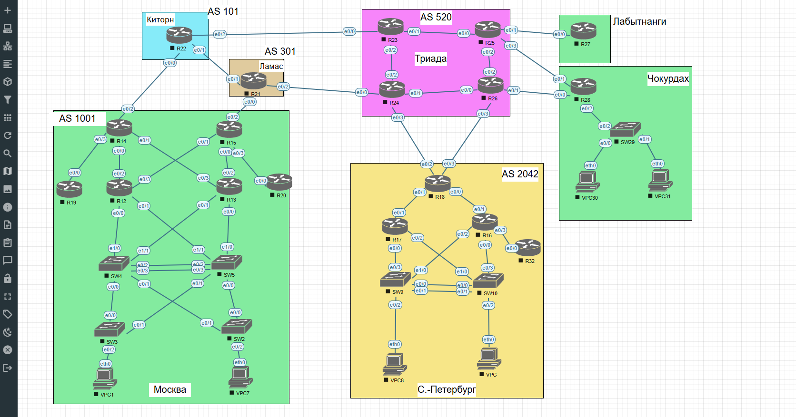

# Лабораторная работа №2. PBR

- [Лабораторная работа №2. PBR](#лабораторная-работа-2-pbr)
  - [Цель работы](#цель-работы)
  - [Задание](#задание)
  - [Топология и план выполнения](#топология-и-план-выполнения)
    - [Адресация](#адресация)
  - [IP SLA и Object Tracking](#ip-sla-и-object-tracking)
  - [Настройка PBR](#настройка-pbr)
  - [Статические маршруты на стороне провайдера](#статические-маршруты-на-стороне-провайдера)
  - [Проверка PBR и отказоустойчивости](#проверка-pbr-и-отказоустойчивости)
    - [Оба канала работают](#оба-канала-работают)
    - [Отказ канала R28–R26](#отказ-канала-r28r26)
    - [Отказ канала R28–R25](#отказ-канала-r28r25)
  - [Маршрут по умолчанию для Лабытнанги](#маршрут-по-умолчанию-для-лабытнанги)
  - [Конфигурации и результат](#конфигурации-и-результат)


## Цель работы

Настроить Policy-Based Routing (PBR) для распределения пользовательского IPv4-трафика между двумя каналами к провайдеру, организовать контроль доступности каналов через IP SLA и Tracking, проверить переключение при отказах и настроить маршрут по умолчанию для офиса Лабытнанги.

## Задание

1. Настроить политику маршрутизации для сетей офиса.
2. Распределить трафик между двумя линками с провайдером.
3. Настроить отслеживание линка через IP SLA (IPv4).
4. Настроить маршрут по умолчанию для офиса Лабытнанги.
5. Зафиксировать план работы и изменения в документации GitHub (Markdown).

## Топология и план выполнения

Использована топология [лабораторной №1](../lab01/README.md) без изменения физических соединений. PBR настроен на R28 (офис Чокурдах), два подключения к AS 520 организованы через R26 и R25.



| Этап | Содержание |
| --- | --- |
| 1 | Проверка каналов R28–R26 и R28–R25, настройка IP SLA и Tracking |
| 2 | Статические и резервные маршруты на R25/R26 для тестовой связности |
| 3 | ACL, route-map и применение PBR к VLAN 301/302 на R28 |
| 4 | Проверка распределения трафика и сценариев отказа |
| 5 | Маршрут по умолчанию на R27 и сохранение конфигураций |

### Адресация

| Устройство | Интерфейс / сеть | IPv4-адрес | Назначение |
| --- | --- | --- | --- |
| R28 | Ethernet0/0 | `10.0.0.66/30` | Подключение к R26 (`10.0.0.65`) |
| R28 | Ethernet0/1 | `10.0.0.86/30` | Подключение к R25 (`10.0.0.85`) |
| R28 | Ethernet0/2.301 | `10.30.1.1/24` | Шлюз VPC30, VLAN 301 |
| R28 | Ethernet0/2.302 | `10.30.2.1/24` | Шлюз VPC31, VLAN 302 |
| R28 | Ethernet0/2.399 | `10.30.99.1/24` | Управляющий VLAN |
| R25 | Loopback0 | `10.255.0.25/32` | Тестовый адрес назначения |
| R25–R26 | R25 E0/2 ↔ R26 E0/2 | `10.0.0.69/30` ↔ `10.0.0.70/30` | Резервный путь |
| R27–R25 | R27 E0/0 ↔ R25 E0/1 | `10.0.0.62/30` ↔ `10.0.0.61/30` | Лабытнанги |

## IP SLA и Object Tracking

На R28 настроены две операции ICMP Echo с периодичностью 5 секунд, `timeout 1000` мс и `threshold 500` мс. Первоначальная попытка установить `timeout 1000` при пороге 5000 мс выдала ошибку; порог был скорректирован перед установкой timeout.

```cisco
ip sla 1
 icmp-echo 10.0.0.65 source-interface Ethernet0/0
 threshold 500
 timeout 1000
 frequency 5
ip sla schedule 1 life forever start-time now
ip sla 2
 icmp-echo 10.0.0.85 source-interface Ethernet0/1
 threshold 500
 timeout 1000
 frequency 5
ip sla schedule 2 life forever start-time now
track 1 ip sla 1 reachability
track 2 ip sla 2 reachability
```

Операции №1 и №2 завершались с кодом `OK`, RTT — 1 мс, `track 1` и `track 2` находились в состоянии `Up` при исправных каналах. При отказе соединений переходы в `Down` подтверждены журналами R28 и выводами `show track`.

## Настройка PBR

Для VLAN 301 основным каналом назначен R26, резервным — R25. Для VLAN 302 порядок обратный. ACL исключают локальный трафик `10.30.0.0/16` из PBR, сохраняя межвлановую маршрутизацию.

```cisco
ip access-list extended PBR-VLAN301
 deny ip 10.30.1.0 0.0.0.255 10.30.0.0 0.0.255.255
 permit ip 10.30.1.0 0.0.0.255 any
ip access-list extended PBR-VLAN302
 deny ip 10.30.2.0 0.0.0.255 10.30.0.0 0.0.255.255
 permit ip 10.30.2.0 0.0.0.255 any
!
route-map PBR-VLAN301 permit 10
 match ip address PBR-VLAN301
 set ip next-hop verify-availability 10.0.0.65 10 track 1
 set ip next-hop verify-availability 10.0.0.85 20 track 2
!
route-map PBR-VLAN302 permit 10
 match ip address PBR-VLAN302
 set ip next-hop verify-availability 10.0.0.85 10 track 2
 set ip next-hop verify-availability 10.0.0.65 20 track 1
!
interface Ethernet0/2.301
 ip policy route-map PBR-VLAN301
interface Ethernet0/2.302
 ip policy route-map PBR-VLAN302
```

Команда `show ip policy` подтвердила применение политик к двум подинтерфейсам. В `show route-map` зарегистрированы совпадения по обоим правилам: VLAN 301 — 14 пакетов, VLAN 302 — 11 пакетов на момент проверки.

## Статические маршруты на стороне провайдера

На R26 добавлен маршрут к тестовому Loopback0 R25 через `10.0.0.69`; связь подтверждена `ping 10.255.0.25` — **5/5**.

Для подсетей `10.30.1.0/24` и `10.30.2.0/24` на R25 и R26 созданы основные и резервные (*floating static*) маршруты:

| Маршрутизатор | Основной next-hop (AD 1) | Резервный next-hop (AD 10) |
| --- | --- | --- |
| R25 | R28 — `10.0.0.86` | R26 — `10.0.0.70` |
| R26 | R28 — `10.0.0.66` | R25 — `10.0.0.69` |

## Проверка PBR и отказоустойчивости

### Оба канала работают

| Источник | Путь до Loopback0 R25 (`10.255.0.25`) | Ping |
| --- | --- | --- |
| VPC30, VLAN 301 | R28 (`10.30.1.1`) → R26 (`10.0.0.65`) → R25 (`10.0.0.69`) | 5/5 |
| VPC31, VLAN 302 | R28 (`10.30.2.1`) → R25 (`10.0.0.85`) | 5/5 |

Трассировки с VPCS подтвердили разные пути при одинаковом IP-адресе назначения. ICMP между VPC30 и VPC31 по-прежнему работает **5/5 в обе стороны**, следовательно локальные подсети не перехватываются политикой PBR.

### Отказ канала R28–R26

На R28 выполнен `shutdown` Ethernet0/0. IP SLA 1 перестал получать ответы (`Timeout`), `track 1` перешёл в `Down`, `track 2` остался `Up`. VPC30 переключился с R26 на R25; обе пользовательские сети сохранили доступность Loopback0 R25 (**5/5**). После `no shutdown` трассировка VPC30 вновь показала путь через R26.

### Отказ канала R28–R25

При `shutdown` Ethernet0/1 на R28 `track 2` перешёл в `Down`, и PBR правильно отправил трафик обоих VLAN через R26. Однако ping до Loopback0 R25 завершился **0/5**: R25 продолжал использовать основной обратный статический маршрут с AD 1 через недоступный `10.0.0.86`. Резервный маршрут с AD 10 не активировался.

После восстановления R28 Ethernet0/1 отказ был повторно смоделирован командой `shutdown` Ethernet0/3 **на R25**. В этом случае R25 удалил непосредственно подключённый маршрут к прямому каналу, установил резервные маршруты с **AD 10** через R26 (`10.0.0.70`), а оба VPC успешно достигли Loopback0 R25 (**5/5**). R25 Ethernet0/3 восстановлен, основные маршруты с AD 1 вернулись; оба Tracking-объекта R28 снова в состоянии `Up`.

**Вывод:** PBR и IP SLA корректно выбирают доступный исходящий канал. Полная отказоустойчивость при одностороннем отказе требует также контроля обратных статических маршрутов на стороне провайдера (например, IP SLA/Tracking на R25/R26).

## Маршрут по умолчанию для Лабытнанги

На R27 настроен маршрут по умолчанию через R25:

```cisco
ip route 0.0.0.0 0.0.0.0 10.0.0.61
```

В `show ip route` подтверждена запись `S* 0.0.0.0/0 [1/0] via 10.0.0.61`. Проверки R27 → R25 (`10.0.0.61`) и R27 → Loopback0 R25 (`10.255.0.25`) завершились **5/5 (100%)**. Конфигурация R27 сохранена в startup-config.

## Конфигурации и результат

Выводы `show running-config` текущей лабораторной сохранены в файлах [`R25.txt`](configs/R25.txt), [`R26.txt`](configs/R26.txt), [`R27.txt`](configs/R27.txt), [`R28.txt`](configs/R28.txt). В них отражены внесённые изменения. Для R26 завершающие служебные строки снимка восстановлены из предыдущей конфигурации, так как присланный вывод оборвался после VTY.

**Итог:** требования по PBR, распределению трафика, IP SLA и маршруту по умолчанию выполнены. Выявленное ограничение переключения обратного маршрута задокументировано.
